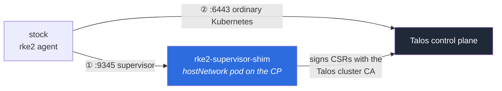
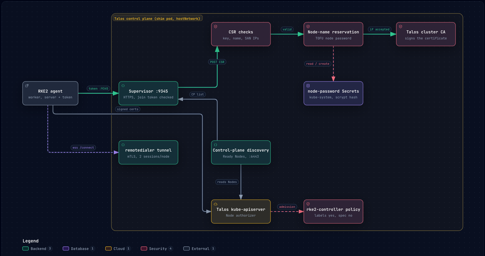

<div align="center">

# rke2-supervisor-shim

**Join stock `rke2 agent` nodes to a Talos Linux control plane.**

Speaks the RKE2 supervisor protocol on port 9345, backed by Talos.<br/>
No changes to the Talos image. No changes to the worker configuration.

[](https://github.com/samr037/rke2-supervisor-shim/actions/workflows/ci.yml)
[](go.mod)
[](LICENSE)
[](docs/compatibility.md#currently-verified)
[](#status)

<a href="docs/media/shim-demo.mp4"></a>

<sub>The demo uses fictional names. <a href="docs/media/shim-demo.mp4">MP4 version</a> · source in <a href="docs/video">docs/video</a></sub>

</div>

---

## Why

An `rke2 agent` refuses Kubernetes' standard kubelet TLS bootstrap. It takes its
identity only from an rke2 server's supervisor on port 9345, and `rke2 server`
cannot be cut down to just that supervisor: its apiserver, controller manager
and scheduler are **static pods run by its own kubelet and containerd**. (k3s
runs them as goroutines in one process, which is why k3s has `--disable-agent`
and RKE2 has no equivalent.)

So with a Talos control plane and an existing fleet of RKE2 workers, you either
rebuild every worker or you speak the protocol. This speaks the protocol.

**The load-bearing fact:** the agent POSTs a DER CSR asking for
`O=system:nodes, CN=system:node:<name>`, which is exactly the identity the
Kubernetes Node authorizer expects. Sign it with the Talos cluster CA and the
agent becomes an ordinary, legitimate node. The shim only ever *signs*; no node
private key is held or transmitted.

## How it works



The shim runs as a DaemonSet on every Talos control-plane node, with
`hostNetwork`. That is required, not a convenience: after bootstrap the agent
dials `<apiserver-ip>:9345` for its tunnel, taking the addresses from
`/v1-rke2/apiservers`, so a supervisor must listen beside every apiserver.

The join path in detail, from the token check to the signed certificate:



The [interactive version](docs/media/architecture.html) (download and open it
in a browser) links every box to the source lines it summarises, at snapshot
`ae4524d`.

| Endpoint | Notes |
|---|---|
| `GET /cacerts` | unauthenticated by design; the agent pins this CA |
| `GET /v1-rke2/config` | a payload captured from a real rke2 server, cluster values overridden |
| `GET /v1-rke2/{client,server}-ca.crt` | one CA for both on Talos; two on an adopted RKE2 cluster |
| `POST /v1-rke2/serving-kubelet.crt` | node-scoped; `CN=<node>` + validated SANs |
| `POST /v1-rke2/client-kubelet.crt` | node-scoped; `O=system:nodes, CN=system:node:<node>` |
| `POST /v1-rke2/client-kube-proxy.crt` | cluster-wide; **no** node headers |
| `POST /v1-rke2/client-rke2-controller.crt` | cluster-wide; **no** node headers |
| `GET /v1-rke2/readyz`, `GET /v1-rke2/apiservers` | control planes discovered from the API |
| `WSS /v1-rke2/connect` | [remotedialer](https://github.com/rancher/remotedialer) tunnel, authenticated by **mTLS** |

Auth is HTTP Basic with the username **literally `node`** and the join token as
password, plus `Rke2-Node-{Name,Password,Ip}` headers on node-scoped calls.
Node passwords are stored as `kube-system` Secrets in rke2's own name and hash
format, so adopted workers keep the ones RKE2 wrote. The shim also emits
`CertificateExpirationWarning` events, exports Prometheus metrics on `:9346`,
and mints and rotates its own serving certificate.

Every protocol fact was captured by proxying a real agent to a real rke2
server, never inferred. Details: [docs/protocol.md](docs/protocol.md).

## Status

| What | Evidence |
|---|---|
| **v1.31.8+rke2r1** agents | ✅ contract captured · joined · 7/7 functional checks · tunnel up |
| **v1.35.7+rke2r1** agents | ✅ contract captured · joined · 7/7 functional checks · tunnel up |
| Two Talos control planes | ✅ both advertised automatically; an agent re-bootstrapped and tunnelled to the pair |
| Adopting a live RKE2 cluster | ✅ end to end on a prod-shaped lab: Talos CP joined, worker migrated, RKE2 CP decommissioned, no downtime |
| **Security hardening of 2026-10-17**, v1.35.7+rke2r1 agent | ✅ **live-verified the same day** on a rebuilt lab: join, 7/7 functional checks, tunnel, reboot re-join, and each new protection exercised against the real shim |
| Hardening with v1.31.8 agents, two control planes, adoption | 🟡 not re-run since the audit (earlier results above predate it) |

Live verification was on Talos v1.13.3 / Kubernetes v1.36.1, workers using a
completely stock rke2 agent config (`server` and `token`, nothing else).
Functional checks: cross-node pod networking both ways, ClusterIP services,
cluster DNS, `kubectl logs`, `kubectl exec`, and the node's system pods.

The post-audit run installed the chart exactly as the quick start below says,
from the signed image, and found three issues that unit tests had not (fixed
since; see [docs/security.md](docs/security.md#live-verification-of-2026-10-17)).

## Quick start

You need: a Talos cluster, its Kubernetes CA certificate and key, and a
`/v1-rke2/config` captured from a real rke2 server of the version your agents
run (the two in `conformance/testdata/` are ready to use).

```bash
git clone --branch v0.1.0 https://github.com/samr037/rke2-supervisor-shim
cd rke2-supervisor-shim

# 1. Namespace. hostNetwork is forbidden by PodSecurity "baseline", which Talos
#    enforces cluster-wide, so this namespace must be "privileged".
kubectl create namespace rke2-shim
kubectl label namespace rke2-shim \
  pod-security.kubernetes.io/enforce=privileged \
  pod-security.kubernetes.io/audit=privileged \
  pod-security.kubernetes.io/warn=privileged

# 2. Secrets, created out of band: one is the cluster CA private key.
kubectl -n rke2-shim create secret generic rke2-shim-pki \
  --from-file=cluster-ca.crt=./cluster-ca.crt \
  --from-file=cluster-ca.key=./cluster-ca.key
kubectl -n rke2-shim create secret generic rke2-shim-token \
  --from-literal=token="$(openssl rand -hex 24)"

# 3. Install, pinned. The token Secret is mounted as a file (--token-file).
helm install shim charts/rke2-supervisor-shim --namespace rke2-shim \
  --set namespace.create=false \
  --set image.tag=0.1.0 \
  --set-file agentConfig.contents=conformance/testdata/v1.35.7+rke2r1/config.json
```

> To track `main` instead of a release, pin the image to a commit SHA
> (`--set image.tag=<full-sha>`). There is no `latest` tag, by design.

Verify the image before it touches your CA key, then pin it by digest
(`--set image.digest=sha256:...`):

```bash
cosign verify ghcr.io/samr037/rke2-supervisor-shim:0.1.0 \
  --certificate-identity-regexp '^https://github.com/samr037/rke2-supervisor-shim/' \
  --certificate-oidc-issuer https://token.actions.githubusercontent.com

gh attestation verify oci://ghcr.io/samr037/rke2-supervisor-shim:0.1.0 \
  -R samr037/rke2-supervisor-shim
```

Workers then use an ordinary rke2 agent config:

```yaml
# /etc/rancher/rke2/config.yaml
server: https://<control-plane-ip>:9345
token: <the token from rke2-shim-token>
```

On a Talos cluster with its default Flannel, also give each worker the CNI
plugins (with `flannel`) in `/opt/cni/bin` and a forwarder on
`127.0.0.1:7445` to the control plane; see [Limitations](#limitations).

Without Helm, apply [`deploy/shim.yaml`](deploy/shim.yaml) (it creates the
labelled namespace itself) after creating the two Secrets and an
`rke2-shim-agent-config` ConfigMap, plus the two admission policies in
[`deploy/`](deploy/) on Kubernetes ≥ 1.30. Then restrict `:9345` and `:9346`
at the host firewall: NetworkPolicy cannot protect a `hostNetwork` pod
([docs/network-security.md](docs/network-security.md)).

Adopting an **existing** RKE2 cluster is a different procedure with its own
CA layout. Start with [docs/risk-register.md](docs/risk-register.md) and run
[`preflight.sh`](examples/adopt-rke2-cluster/preflight.sh); do not hand-write
the Talos machine config.

## Security

The shim signs certificates with the cluster CA, so it is part of the control
plane's trust boundary. What it guarantees, each pinned by unit tests:

- **Certificate subjects come from the endpoint**, never from the CSR.
- **A join token alone cannot become an existing node.** A node with a password
  on record must present it; a Node without one (every Talos control plane) is
  refused with `409` rather than enrolled.
- **What a token holder can get a certificate *for* is bounded:** node names
  must be DNS-1123 and not reserved names, serving-cert IPs must be routable
  node addresses outside the service CIDR and not a control plane, and CSR keys
  must be ECDSA P-256+, Ed25519 or RSA ≥ 2048.
- **The token is read from a file** and never printed; tunnel sessions require
  a real node identity and are capped per node and per message; scrypt cost,
  request sizes and timeouts are bounded.
- **The supply chain is pinned:** signed images with SLSA provenance, no
  `latest`, actions pinned by SHA, the base image pinned by digest.
- **Admission policies** limit the shim's Secret writes to
  `*.node-password.rke2` and the shared `system:rke2-controller` identity to
  node labels and annotations.

What it does not protect against is in [Limitations](#limitations). The full
audit — threat model, every finding with its severity and test, residual risks
— is [docs/security.md](docs/security.md).

## Documentation

| Document | What it covers |
|---|---|
| [docs/risk-register.md](docs/risk-register.md) | every finding from the adoption work, ranked by how strongly it argues against doing this. **Start here for a go/no-go** |
| [docs/security.md](docs/security.md) | threat model, the 2026-10-17 audit, residual risks, image verification |
| [docs/architecture.md](docs/architecture.md) | topology, bootstrap sequence, trust chains, component map |
| [docs/protocol.md](docs/protocol.md) | every endpoint, header and gotcha of the supervisor protocol, as captured |
| [docs/compatibility.md](docs/compatibility.md) | how RKE2 upgrades are detected before production; the capture pipeline |
| [docs/certificates.md](docs/certificates.md) | lifetimes, renewal, expiry alerting, the CA-rotation runbook |
| [docs/network-security.md](docs/network-security.md) | why NetworkPolicy cannot protect the shim, and the host firewalls that can |
| [docs/migration-from-rke2.md](docs/migration-from-rke2.md) | adopting an existing RKE2 cluster with a Talos control plane, RKE2 untouched |
| [docs/runbook.md](docs/runbook.md) | operating that migration phase by phase, with gates, timings and rollback |
| [docs/control-plane-vip.md](docs/control-plane-vip.md) | the control-plane VIP through the migration, and the ~0.7 s handover |
| [docs/kubelet-egress.md](docs/kubelet-egress.md) | how each control plane reaches kubelets; the measured reachability matrix |
| [docs/benchmarks.md](docs/benchmarks.md) | what the supervisor costs per bootstrap, and the levers |
| [charts/rke2-supervisor-shim](charts/rke2-supervisor-shim/README.md) | Helm chart values and why some things are not templated |
| [conformance/](conformance/README.md) | captured protocol contracts and how they are recorded |
| [examples/adopt-rke2-cluster/](examples/adopt-rke2-cluster/) | `preflight.sh` and the phased `adopt.sh` driver |
| [examples/kube-vip/](examples/kube-vip/) | control-plane VIP manifests for both distributions |
| [CLAUDE.md](CLAUDE.md) | conventions for AI assistants (and humans) working in this repo |

## Limitations

- **Nothing from the 2026-10-17 security audit has been run against a real
  agent.** Unit tests and review only, until someone re-runs the live checks.
- **The pod holds the cluster CA private key.** Compromising it compromises the
  cluster. Unavoidable: `serving-kubelet` and the two cluster identities have
  no built-in Kubernetes signer that fits. Treat RBAC on its namespace as
  cluster-admin-equivalent.
- **The shim can read every Secret in `kube-system`.** RBAC cannot scope reads
  by name suffix; the admission policy narrows writes only.
- **The join token is high value.** It enrols new nodes and yields the shared
  `system:rke2-controller` identity, which can still change ordinary labels and
  annotations on any Node, and `nodes/status`. Store and rotate it like a
  cluster credential.
- **Metrics on `:9346` are unauthenticated** when enabled. Firewall them, bind
  them to loopback, or turn them off with `--metrics-listen=""`.
- **CA rotation is a manual runbook**, deliberately not automated.
- **Expiry warnings are verified synthetically**, never by a genuinely aged
  certificate.
- **Workers need two things the agent does not install** on a Talos cluster
  running its default Flannel (observed with v1.35.7 on 2026-10-17):
  the CNI plugins plus the `flannel` plugin in `/opt/cni/bin` (the agent left
  that directory absent), and something listening on `127.0.0.1:7445`, where
  Talos points its Flannel DaemonSet (KubePrism exists only on Talos nodes;
  an HAProxy forwarding to the control-plane endpoints is enough). Without
  them pods on the worker stay in `ContainerCreating`.
- **During an adoption, the Talos apiserver cannot reach un-migrated RKE2
  kubelets** (`401`): Talos has one signing key where RKE2 has two. It shrinks
  as workers migrate. See [docs/kubelet-egress.md](docs/kubelet-egress.md).
- **Removing the last RKE2 control plane upgrades etcd** from RKE2's 3.5 to
  Talos' 3.6, one way. Snapshot first.

## Contributing

```bash
go test ./...   # replays captured protocol contracts; no cluster needed
go vet ./...
gofmt -l .
```

The protocol is undocumented, so **capture, do not guess**. To support a new
RKE2 version:

1. `./conformance/capture.sh <version> <user@throwaway-vm>` installs a real rke2
   server of that version on a disposable VM (installer checked against a
   pinned sha256) and records the endpoint matrix and a scrubbed
   `/v1-rke2/config` into `conformance/testdata/<version>/`.
2. `git diff conformance/testdata/` and read every line of it.
3. `go test ./...` replays the new contract against the shim.
4. Join one real agent of that version to a staging Talos cluster and confirm
   `Ready` plus pod networking. Only then is the version *verified*.
5. Commit the testdata and add the version to
   [docs/compatibility.md](docs/compatibility.md#currently-verified).

In docs and PRs, keep the distinction between *captured*, *verified* on a live
cluster, and *believed* or *unit-tested only*. Add a regression test before a
fix, and never weaken an existing one to make a change pass. More in
[CLAUDE.md](CLAUDE.md).

## License

MIT — see [LICENSE](LICENSE). Uses [`rancher/remotedialer`](https://github.com/rancher/remotedialer)
(Apache-2.0) so the tunnel wire format is identical by construction rather than
reimplemented.
